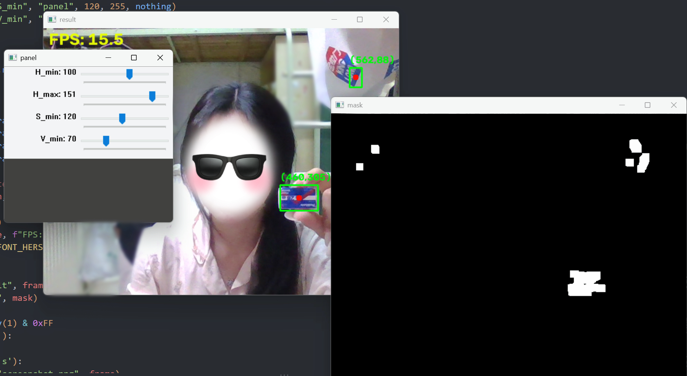

# 装甲板灯条颜色识别与追踪

仿 RoboMaster 传统视觉检测流程的入门项目。

## 效果图

## 技术流程
高斯滤波 → HSV 颜色阈值分割 → 形态学开运算去噪 → 
轮廓提取 + 面积/长宽比几何筛选 → 输出目标中心坐标与实时 FPS

## 环境
Python 3.x + OpenCV（pip install opencv-python numpy）

## 运行
python detector.py        # 摄像头模式
按 S 截图，按 Q 退出，滑动条实时调节 HSV 阈值

## 已知不足与改进方向
- 红色目标需合并 [0,10] 与 [170,180] 两段色调范围
- 下一步：拟合灯条对匹配装甲板、引入 Kalman Filter 做轨迹预测
